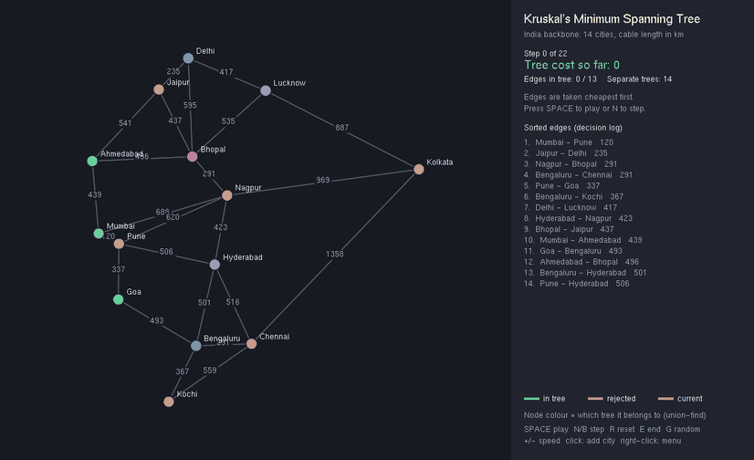
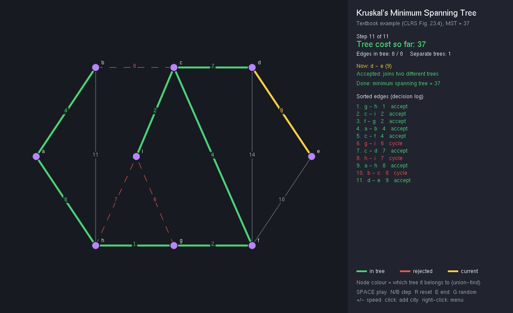

# Kruskal's Minimum Spanning Tree: Interactive OpenGL Visualiser (C++)

This program animates **Kruskal's algorithm** step by step in OpenGL. It sorts the edges, accepts the cheapest edge that joins two different trees, and rejects any edge that would close a cycle. Node colours show the union-find sets merging live.

It includes a real-world example: the cheapest fibre-optic backbone joining 14 Indian cities. Laying cable only on the MST needs **5,233 km** instead of the **12,621 km** of all candidate links, which is **59% less cable** while still connecting every city.



Team project (SY-D-32, VIT Pune): Shubhan Punde, Saif Khan, Rahul Sakpal, Soham Kasurde. The original project report is in [`docs/Project_Report.pdf`](docs/Project_Report.pdf).

## What changed from the first version

| | v1 (`legacy/Source.cpp`) | v2 (this) |
|---|---|---|
| Algorithm | Rescanned the whole cost matrix for the minimum on every step (O(V²) per edge) | True Kruskal: sort once, then union-find with path compression + union by rank, O(E log E) |
| Union-find bug | `s[v] = u` linked the *vertex*, not its root, which can corrupt the sets | Roots are linked, so the sets stay correct |
| Input | Typed an n×n cost matrix in the console; `scanf_s` built only on Windows | Graph files (names, positions, weights, or `auto` distances), random graphs, click-to-add |
| Size | 10 nodes max, weights up to 99, cost up to 999 | Any size, any weight |
| Animation | Busy-wait `for` loops froze the window | `glutTimerFunc` animation: play/pause, step forward **and back**, speed control |
| Visual feedback | Final tree only | Current edge, accepted, rejected (cycle), per-tree node colours, running cost, decision log |
| Colour bug | `glColor3f(032, …)`: octal 032 = 26 | Fixed palette |
| Portability | Visual Studio only | Linux, macOS, Windows (freeglut); a no-graphics CLI too |
| Correctness checks | – | 1,560 test checks, incl. Kruskal = Prim on 500 random graphs |

## Features

- **Step-by-step animation:** SPACE play/pause, N/→ next, B/← back, R reset, E run to end, +/− speed.
- **What every colour means:** yellow = the edge being considered now, green = in the tree, dashed red = rejected because it would form a cycle. Each node is coloured by the **union-find set** it belongs to, so you can watch separate trees merge into one.
- **Side panel:** step counter, tree cost so far, edges used out of V−1, number of separate trees, the reason for the current decision, and the sorted edge log.
- **Build your own graph:** left-click adds a city joined to its 3 nearest neighbours; G makes a random connected graph; the right-click menu (kept from the original) offers the same actions.
- **Disconnected graphs** are detected and reported as a minimum spanning *forest*.
- **Headless screenshots** (`--screenshot out.ppm --step k`) generated the GIFs in this README.

## Example 1: the textbook graph (verifies correctness)

`data/clrs_example.txt` is Figure 23.4 from Cormen et al., *Introduction to Algorithms*, whose MST weight is known to be **37**. The program finds 37 using 8 of 14 edges, rejecting g–i, h–i and b–c as cycles.



## Example 2: a real use case, an India fibre backbone

`data/india_fibre_network.txt` lists 14 cities by latitude and longitude and 24 candidate links along major corridors. Each weight is the great-circle distance in km, computed by the program (`auto`).

| | Cable length |
|---|---|
| Build every candidate link | 12,621 km |
| **Minimum spanning tree (13 links)** | **5,233 km (−59%)** |

Links chosen: Mumbai–Pune 120 · Jaipur–Delhi 235 · Nagpur–Bhopal 291 · Bengaluru–Chennai 291 · Pune–Goa 337 · Bengaluru–Kochi 367 · Delhi–Lucknow 417 · Hyderabad–Nagpur 423 · Bhopal–Jaipur 437 · Mumbai–Ahmedabad 439 · Goa–Bengaluru 493 · Ahmedabad–Bhopal 496 · Lucknow–Kolkata 887. The same idea plans power grids, water pipes, road networks and cluster analysis.

## Build and run

```bash
# Ubuntu/Debian: sudo apt install build-essential freeglut3-dev
# macOS: uses the system GLUT framework
make                    # builds ./kruskal_viz (OpenGL) and ./kruskal_cli (no graphics)
make test               # 1,560 checks under AddressSanitizer + UBSan

./kruskal_viz data/india_fibre_network.txt
./kruskal_viz data/clrs_example.txt
./kruskal_viz                              # random graph; press G for another
./kruskal_cli data/clrs_example.txt        # prints every step as a table
```

Windows: install freeglut (e.g. via vcpkg or MSYS2) and build `src/viz.cpp` + `src/kruskal.cpp` with `-lfreeglut -lopengl32 -lglu32`.

## Graph file format

```
TITLE My network
NODE A 0.1 0.2            # name, x, y in 0..1 canvas coordinates
LATLON Pune 18.52 73.86   # or geographic coordinates (weights in km)
EDGE A B 7                # explicit weight
EDGE Pune Mumbai auto     # weight = distance
COMPLETE 100              # optional: connect every pair
```

## How Kruskal's algorithm works

1. Sort all edges by weight, cheapest first. Ties are broken by endpoints, so runs are reproducible.
2. Start with every node as its own tree (union-find: V separate sets).
3. For each edge (u, v): if `find(u) ≠ find(v)`, the edge joins two trees, so **accept** it and `unite` them. Otherwise both ends are already connected, so **reject** it (it would make a cycle).
4. Stop when V−1 edges are accepted. If the edges run out first, the graph is disconnected.

The cost is O(E log E) for sorting plus nearly O(E) for union-find, thanks to path compression and union by rank.

## Structure

```
src/kruskal.hpp/.cpp   graph model, DSU, step-recording Kruskal, Prim (for verification), file loader, random graphs
src/viz.cpp            OpenGL/freeglut visualiser
src/cli.cpp            terminal version (prints the step table)
tests/test_kruskal.cpp correctness tests
data/                  clrs_example.txt, india_fibre_network.txt
docs/                  GIFs, screenshots, step logs, original report
legacy/Source.cpp      the original 2023 version, kept for comparison
```
